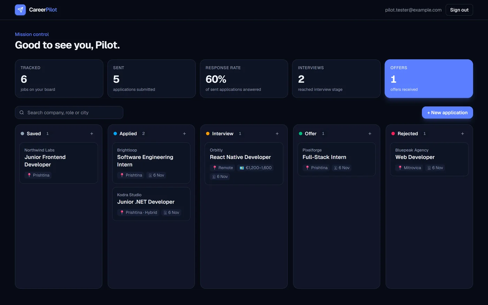

# 🧭 CareerPilot

**Your job search, finally under control.**

CareerPilot keeps every job application on one Kanban board — from the first save to the offer — and shows the numbers that matter: how many applications you sent, your response rate, interviews and offers. Built for students entering the job market.

> **Live demo:** [career-pilot-weld-six.vercel.app](https://career-pilot-weld-six.vercel.app) · **Status:** MVP with AI co-pilot



---

## ✨ Features

- **Kanban pipeline** — Saved → Applied → Interview → Offer → Rejected, with drag and drop on desktop and a "Move to" menu on mobile
- **Stats at a glance** — applications tracked and sent, response rate, interviews and offers
- **Full application details** — company, position, location, salary range, job link and notes
- **Instant search** across company, role and city
- **Optimistic UI** — cards move immediately while the change is saved in the background
- **Sample data** — fill an empty board with demo applications in one click
- **Secure accounts** — Supabase Auth with server-side session checks
- **Private by design** — Postgres Row Level Security: every user can only read and change their own rows
- **Dark and light theme** following the system setting
- ✨ **AI co-pilot (Claude)** — paste a job post and get a 0–100 match score against your CV, the requirements you already meet, missing keywords, concrete CV edits and a tailored cover letter

### Coming next
- CV upload from PDF
- Interview reminders and follow-up dates

## 🛠 Tech stack

| Layer | Technology |
| --- | --- |
| Framework | Next.js 16 (App Router, Server Components, Server Actions) |
| Language | TypeScript, React 19 |
| Styling | Tailwind CSS 4 |
| Auth & database | Supabase (Auth, PostgreSQL, Row Level Security) |
| AI | Claude API (`@anthropic-ai/sdk`) with structured outputs |
| Hosting | Vercel |

## 🏗 How it works

- **Server Components** load the board on the server, so the page arrives with data already rendered.
- **Server Actions** (`src/app/dashboard/actions.ts`) handle create, update, move and delete — each one verifies the signed-in user and validates input.
- **`src/proxy.ts`** (Next.js 16's replacement for middleware) refreshes the Supabase session and redirects signed-out visitors away from the dashboard.
- **AI co-pilot** (`src/lib/copilot.ts`) calls Claude with a Zod schema as a structured output, so the response is always valid, typed JSON. The CV and job post are treated as untrusted data in the prompt, each user gets a daily analysis limit, and every result is stored in `ai_analyses` behind RLS.
- **Database rules live in the database** — `supabase/schema.sql` defines RLS policies, length checks and a trigger that keeps `updated_at` fresh and stamps `applied_at` the first time an application leaves "Saved".

## 🚀 Run locally

```bash
npm install
cp .env.local.example .env.local   # add your Supabase URL, publishable key and Anthropic API key
npm run dev
```

1. Create a Supabase project and run `supabase/schema.sql` in the SQL editor.
2. In **Authentication → Sign In / Providers → Email**, keep the provider enabled and turn **Confirm email** off for a frictionless demo.
3. Open <http://localhost:3000>.

## 📁 Project structure

```
src/
├── app/
│   ├── (auth)/          # login, signup and auth server actions
│   ├── auth/confirm/    # email confirmation callback
│   ├── dashboard/       # board page and application server actions
│   └── page.tsx         # landing page
├── components/          # Board, ApplicationDialog, StatsBar, Logo
├── lib/                 # Supabase clients and application types
└── proxy.ts             # session refresh and route protection
supabase/schema.sql      # tables, RLS policies and triggers
```

## 👤 Author

**Arianit Xhafa** — [Portfolio](https://arianitxhafa.github.io) · [GitHub](https://github.com/Arianitxhafa) · [LinkedIn](https://www.linkedin.com/in/arianit-xhafa-910228408)
